# Week 4 Demo Evidence

This page contains evidence from the current Week 4 deployment. Add new screenshots only when they show a specific requirement working in this environment.

## Coffee Store order and notification flow

The public storefront shows two placed orders with matching notification updates. The SNS email for order `9f7a9c0b` matches the Ethiopia Yirgacheffe order and its $18.50 total. Together, these screenshots demonstrate the customer-visible order, in-app update, and email delivery. They do not by themselves verify each internal EventBridge/SQS hop or DLQ behavior.

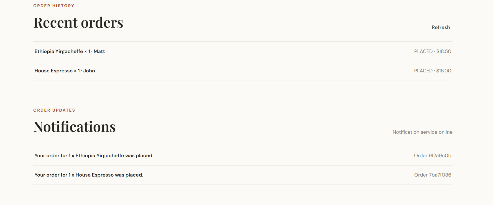

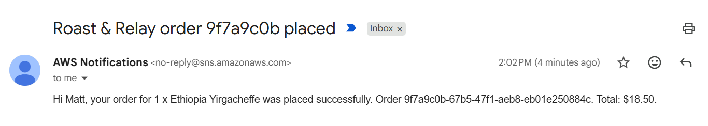

## EKS application deployment

The `Deploy Coffee Store to EKS` run #21 completed successfully. Its job steps show the five application images were built and scanned, published to ECR, deployed with Helm, checked for successful rollouts, and smoke-tested through the frontend. This verifies the deployment workflow and a successful post-deployment check; the overview does not show individual Trivy finding totals or current HPA/VPA values.

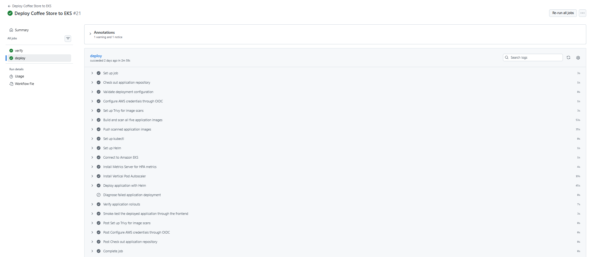

## CloudWatch platform dashboard

The current `guduf-retail-eks-dev-platform` dashboard shows time-series data for EKS node CPU and memory utilization, RDS CPU and database connections, and Coffee Store Pod CPU and memory utilization. This demonstrates that resource metrics are reaching CloudWatch; it does not demonstrate application request latency, error rate, or throughput.

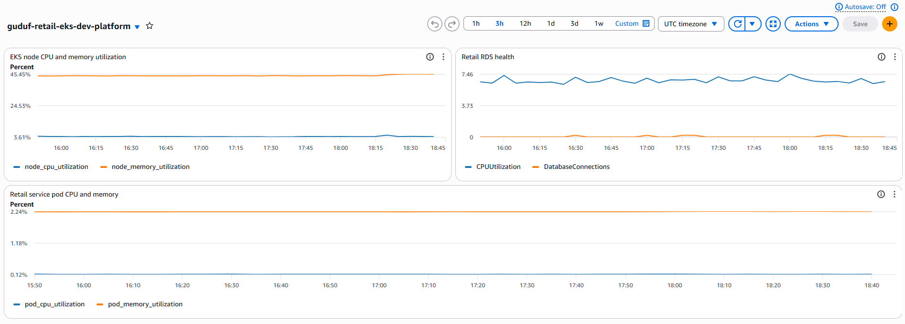

## CloudWatch application logs

A recent `order-service` entry in the EKS application log group shows a timestamp, the `coffee-store` namespace and Pod metadata, and a successful `GET /health` response. This verifies that application container logs are reaching CloudWatch. A health-check entry does not by itself prove order processing or an end-to-end transaction.

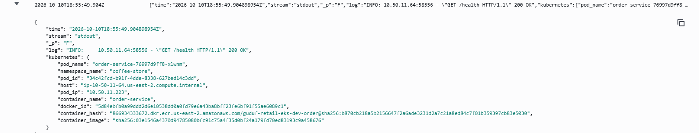

## Application Load Balancer monitoring

The Coffee Store ALB monitoring view shows incoming requests and measured target response time. The selected time range has no datapoints for target 5xx or ELB 5xx; this should not be described as proof of zero errors. An ELB 4xx spike appears near the end of the range and needs investigation before claiming the traffic was entirely healthy.

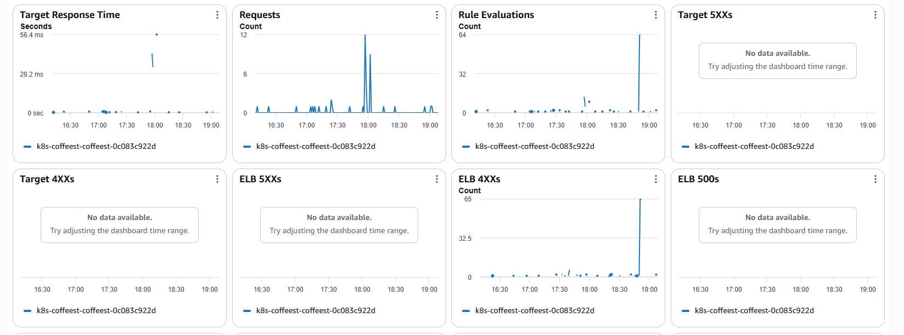

## Order notification dead-letter queue alarm

The CloudWatch alarm `guduf-retail-eks-dev-order-notification-dlq-not-empty` is currently OK. It evaluates the maximum visible-message count for the order-notification DLQ every five minutes and enters ALARM when the count is at least one for one datapoint. Its enabled alarm action publishes to the `guduf-retail-eks-dev-monitoring-critical-events` SNS topic. These screenshots verify the alarm configuration, not that a recipient subscription is confirmed or that an incident notification was delivered.

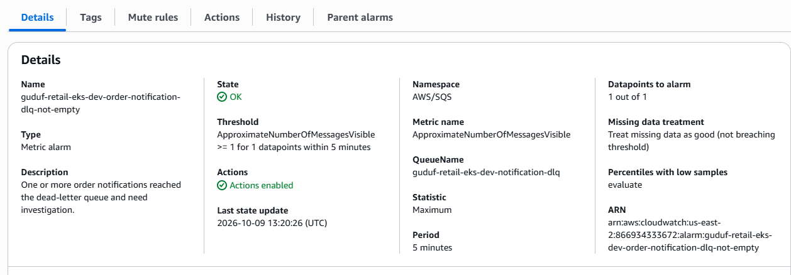

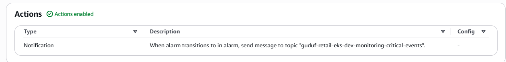

A manually published test message to the monitoring SNS topic arrived by email. This verifies topic-to-email delivery, but it does not verify that the CloudWatch alarm entered ALARM or published a notification.

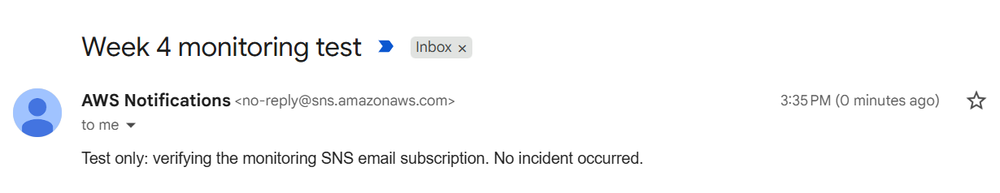

A clearly labeled synthetic message was sent directly to the notification DLQ after its available-message count was checked at zero. The DLQ alarm then entered `In alarm` at 2026-10-10 19:42:26 UTC. This demonstrates detection of DLQ backlog; it does not demonstrate automatic redrive from the primary queue, alert-email delivery, or recovery yet.

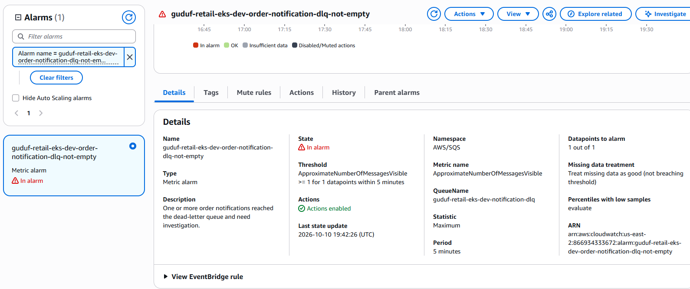

The alarm History identified the initial notification failure: CloudWatch Alarms was not authorized to use the SNS topic encryption key. Terraform was then updated to use a dedicated customer-managed KMS key with scoped CloudWatch alarm access. This screenshot records the failure diagnosis before remediation.

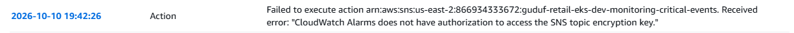

After the Terraform fix was applied, a second labeled synthetic message triggered the alarm at 2026-10-10 20:39:26 UTC. Alarm History shows a successful action to the monitoring SNS topic, and the matching CloudWatch ALARM email was received. This verifies detection and notification end to end for a directly injected DLQ message; it does not demonstrate automatic dead-lettering from the primary queue.

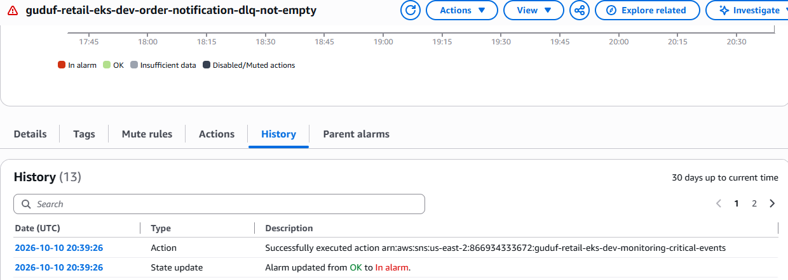

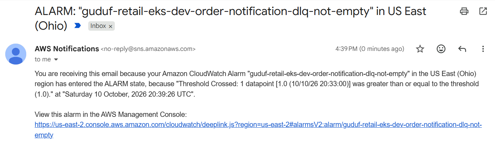

Alarm History shows the state returned from `In alarm` to `OK` at 2026-10-10 20:48:26 UTC. This verifies alarm recovery; the screenshot does not independently show the DLQ's final message count.

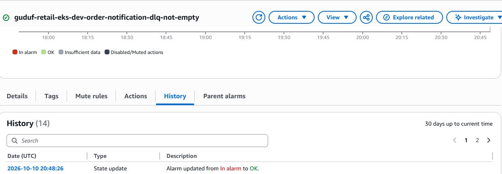

The SQS console row for `guduf-retail-eks-dev-notification-dlq` shows zero messages available and zero messages in flight after the alarm recovered.

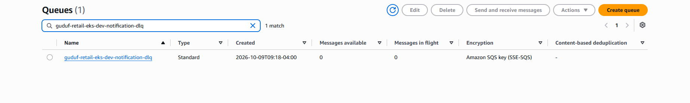

## CloudTrail audit logging

The `guduf-retail-eks-dev` multi-Region trail is logging management events to its S3 destination. The console shows log-file validation enabled, SSE-KMS encryption enabled with the customer-managed key, and a recent successful log-file delivery. This verifies trail status and delivery configuration; it does not establish that S3 log access is monitored or that the trail is organization-wide.

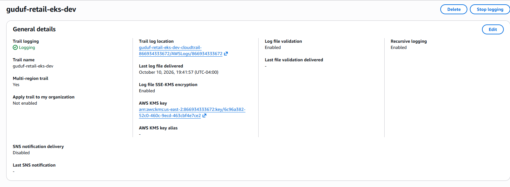

## Cost Explorer baseline

The refreshed, project-specific Cost Explorer export records $17.141 in unblended costs for October 7–11, 2026: $0 on October 7–8, $3.501 on October 9, $9.562 on October 10, and $4.078 on October 11. October 11 is a partial day, so this is a short-period baseline, not a monthly estimate or proof of savings. The refreshed service totals are EKS ($4.750), CloudWatch ($4.724), EC2 instances ($3.060), EC2-Other ($2.480), and RDS ($1.749). The dated export below is the current snapshot; the older October 7–10 export is retained as a prior snapshot and should not be treated as a comparable before/after measurement.

[Refreshed Cost Explorer service breakdown CSV, October 7–11](demo-evidence/week4-cost-explorer-service-breakdown-2026-10-07-to-11.csv)

The usage-type screenshots show EKS cluster-hours, CloudWatch observation/log usage, and EC2-Other charges led by NAT Gateway hours. These are candidate cost drivers to evaluate; no optimization savings have been measured.

[Cost Explorer service breakdown CSV](demo-evidence/week4-cost-explorer-service-breakdown.csv)

The EC2-Other usage-type export shows NAT Gateway hours ($1.13) as its largest charge, followed by NAT data processing ($0.14), regional data transfer ($0.04), and gp3 EBS storage ($0.03). Investigate these usage types before selecting an optimization; no savings have been measured yet.

[Cost Explorer EC2-Other usage breakdown CSV](demo-evidence/week4-cost-explorer-ec2-other-usage-breakdown.csv)

## CI security scan evidence

The Platform CI scan job for commit `3d3679f` succeeded. Gitleaks reported no leaks in the commit it scanned; its output says one commit was scanned, so this run does not establish that the full Git history is clean. Checkov reported 221 passed, zero failed, and 40 skipped checks for Terraform, Docker, Kubernetes, and workflow configuration. The skipped checks have inline explanations for lab tradeoffs or controls implemented in separate Terraform resources. Trivy filesystem and event-producer image scans completed successfully under the configured High/Critical, ignore-unfixed gates. The captured logs do not include Trivy finding totals. The Node.js and Checkov deprecation warnings are tooling notices, not security findings.

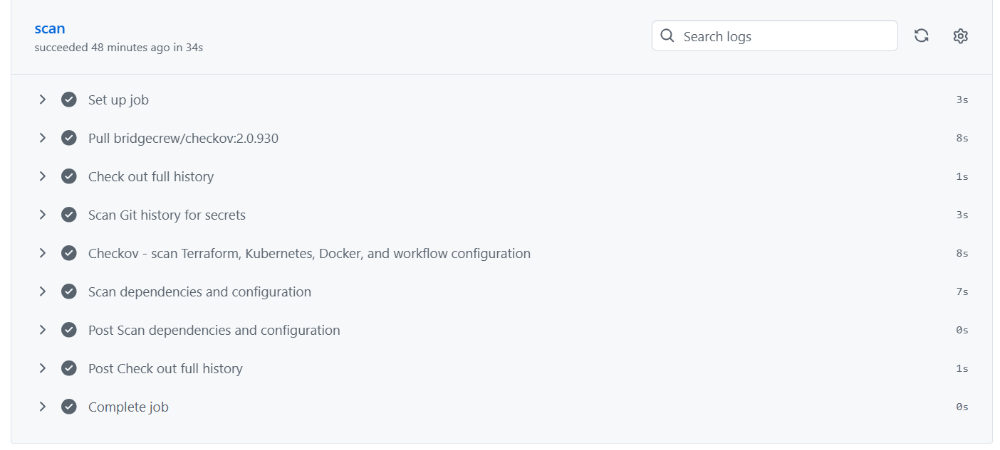

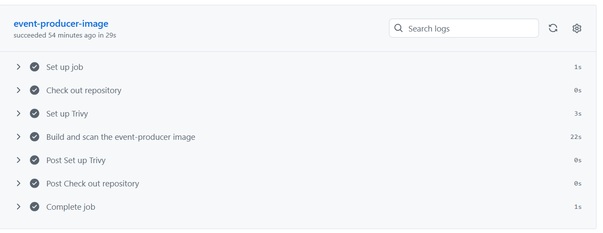

## Terraform drift detection

The Terraform workflow screenshot shows the `Detect infrastructure drift (scheduled or manual)` job step completed successfully. The Apply step was skipped in this run, so this is evidence of drift detection only, not a Terraform apply.

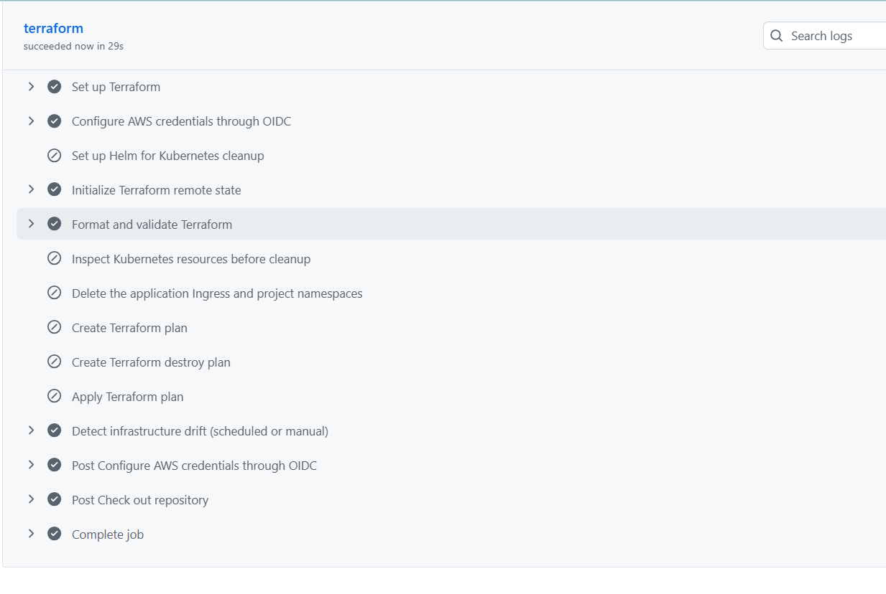

## Prometheus and Grafana deployment

The manually triggered GitHub Actions workflow successfully installed the pinned `kube-prometheus-stack` release in the EKS `observability` namespace. The EKS console showed Grafana, Prometheus, the Prometheus operator, and kube-state-metrics Pods running. One node-exporter Pod remained Pending.

The scheduler event reported that no node was eligible: one node had reached its Pod capacity, while the other did not satisfy the Pod's node-affinity rules. This is a scheduling constraint, not evidence that Grafana or Prometheus failed. The Pending exporter may limit host-level metrics; it does not establish that all monitoring metrics are unavailable.

This is a development lab deployment. Grafana and Prometheus use internal ClusterIP services, and Prometheus storage is ephemeral. The initial deployment did not create a public Grafana URL. An optional HTTPS ingress can be enabled after ACM and Route 53 setup; see `grafana-access.md`. CloudWatch remains the primary evidence for the project's existing logs, metrics, and alarms.

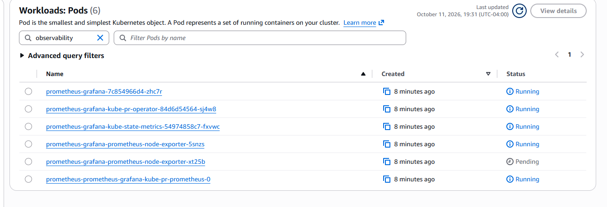

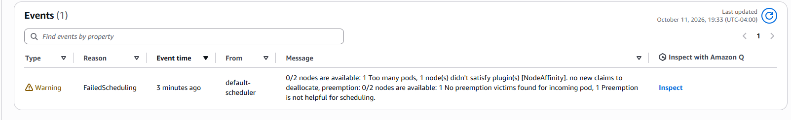
